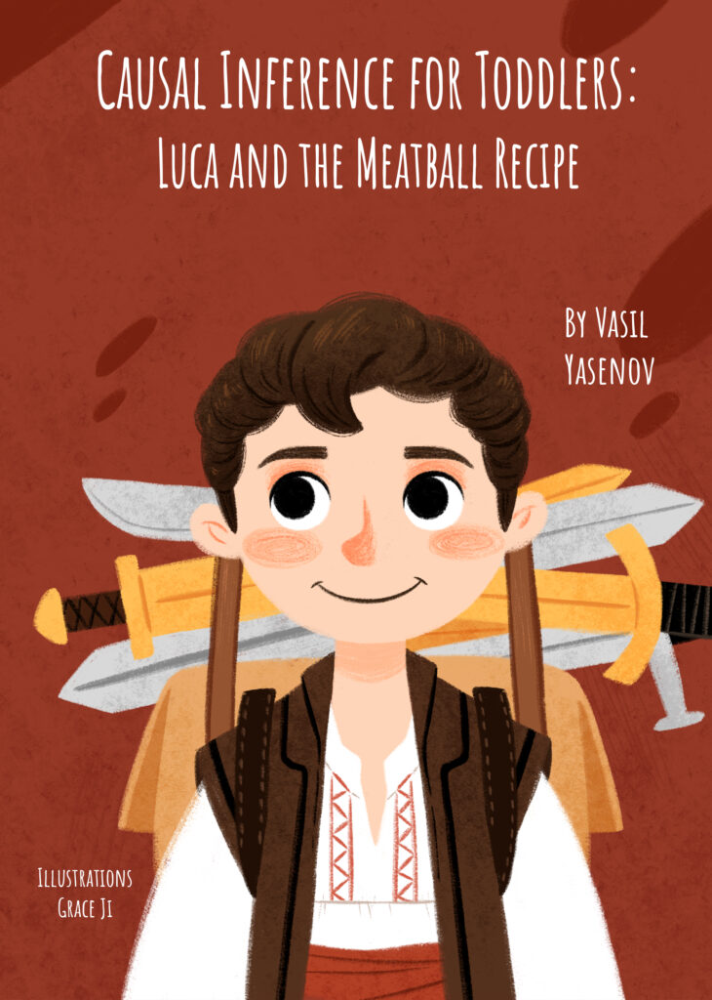

I develop and apply causal inference and machine learning tools to solve challenging problems with data.

_________

I'm a Staff Data Scientist at [Adobe](https://business.adobe.com){target="_blank"} and a researcher at the [Immigration Policy Lab](https://immigrationlab.org/){target="_blank"} at Stanford University.

Previously, I held postdoctoral positions at UC Berkeley and Stanford. My PhD dissertation combined natural experiments with innovative statistical methods to study the wage/employment effects of immigration and the consequences of [double-shift](https://en.wikipedia.org/wiki/Double_shift_school){target="_blank"} schooling systems.

My [academic research](https://vyasenov.github.io/research.html){target="_blank"} has been published in leading peer-reviewed journals in *labor economics*, *political science*, *medicine*, and *general science* and has been featured by [The New York Times](https://www.nytimes.com/2017/10/24/business/economy/immigration-jobs.html){target="_blank"}, [The Washington Post](https://www.washingtonpost.com/politics/2020/04/07/trump-administration-is-raising-application-fee-us-citizenship-that-will-cost-us-later/){target="_blank"}, and [The Wall Street Journal](https://www.wsj.com/articles/new-evidence-on-immigrants-and-jobs-1453162462){target="_blank"}.

******

Throughout my career, I’ve been fortunate to work closely with multiple mentors who were students of Nobel Prize laureates. As a way to give back, I maintain [a blog](https://vyasenov.github.io/blog/){target="_blank"} that makes cutting-edge academic research in data science accessible to a broader audience.

My [children’s book](#kids-books) on causal inference reached $\#2$ on Amazon’s *New Releases in Probability and Statistics* list.

******

Outside of work, I’m an avid mushroom forager and mountain biker—but most of all, I love spending time with my family away from concrete. Originally from [Asenovgrad](https://en.wikipedia.org/wiki/Asenovgrad){target="_blank"}, Bulgaria, I now live in the San Francisco Bay Area with my wife and our son, Luca.

******

Oh, and my [Erdős number](https://en.wikipedia.org/wiki/Erd%C5%91s_number){target="_blank"} is $8$.

## Kids Books

```{=html}
<div class="grid text-center">
  <div class="g-col-12 g-col-md-6">
    <a href="files/ml-toddlers-eng-reduced.pdf" target="_blank" rel="noopener noreferrer">
      
    </a>
    <div class="d-flex flex-wrap justify-content-center gap-2 mt-3" role="group" aria-label="Machine Learning for Toddlers links">
      <a class="btn btn-outline-primary btn-sm" href="files/ml-toddlers-eng-reduced.pdf" target="_blank" rel="noopener noreferrer">English (PDF)</a>
      <a class="btn btn-outline-primary btn-sm" href="files/ml-toddlers-bg-reduced.pdf" target="_blank" rel="noopener noreferrer">Български (PDF)</a>
      <a class="btn btn-outline-primary btn-sm" href="https://www.amazon.com/Machine-Learning-Toddlers-Mushrooms-Mystery/dp/B0G19Z88W9" target="_blank" rel="noopener noreferrer">Amazon (paperback)</a>
    </div>
  </div>
  <div class="g-col-12 g-col-md-6">
    <a href="files/ci-toddlers-eng-reduced.pdf" target="_blank" rel="noopener noreferrer">
      
    </a>
    <div class="d-flex flex-wrap justify-content-center gap-2 mt-3" role="group" aria-label="Causal Inference for Toddlers links">
      <a class="btn btn-outline-primary btn-sm" href="files/ci-toddlers-eng-reduced.pdf" target="_blank" rel="noopener noreferrer">English (PDF)</a>
      <a class="btn btn-outline-primary btn-sm" href="files/ci-toddlers-bg-reduced.pdf" target="_blank" rel="noopener noreferrer">Български (PDF)</a>
      <a class="btn btn-outline-primary btn-sm" href="https://www.amazon.com/dp/B0BLG6SWZJ?ref_=pe_3052080_397514860" target="_blank" rel="noopener noreferrer">Amazon (paperback)</a>
    </div>
  </div>
</div>
```